---
#
# Licensed to the Apache Software Foundation (ASF) under one
# or more contributor license agreements.  See the NOTICE file
# distributed with this work for additional information
# regarding copyright ownership.  The ASF licenses this file
# to you under the Apache License, Version 2.0 (the
# "License"); you may not use this file except in compliance
# with the License.  You may obtain a copy of the License at
#
#   http://www.apache.org/licenses/LICENSE-2.0
#
# Unless required by applicable law or agreed to in writing,
# software distributed under the License is distributed on an
# "AS IS" BASIS, WITHOUT WARRANTIES OR CONDITIONS OF ANY
# KIND, either express or implied.  See the License for the
# specific language governing permissions and limitations
# under the License.
#
title: "Integrating Apache Polaris with PuppyGraph for Real-time Graph Analysis"
date: 2025-10-02
author: Danfeng Xu
---

Unified data governance has become a hot topic over the last few years. As AI and other data-hungry use cases infiltrate the market, the need for a comprehensive data catalog solution with governance in mind has become critical. [Apache Polaris](https://github.com/apache/polaris) has found its calling as an open-source solution, specifically built to handle data governed by [Apache Iceberg](https://iceberg.apache.org/), that is changing the way we manage and access data across various clouds, formats, and platforms. With a foundation rooted in Apache Iceberg, Apache Polaris ensures compatibility with various compute engines and data formats, making it an ideal choice for organizations focused on scalable, open data architectures. 

The beauty of such catalog technologies is their interoperability with other technologies that can leverage their data. [**PuppyGraph**](https://www.puppygraph.com/), the first graph compute engine to integrate with Apache Polaris natively, is part of this revolution of making data (and graph analytics) more accessible \- all without a separate specialized graph database. By working with the Apache Polaris team, PuppyGraph’s integration with the Apache Polaris is a significant leap forward in graph compute technology, offering a unique and powerful approach to exploring and analyzing data within Apache Polaris.

As the first graph query engine to natively integrate with Apache Polaris, PuppyGraph offers a unique approach to querying the data within an Apache Polaris instance: **through graph**. Although SQL querying will remain a staple for many developers, graph queries offer organizations a way to explore their interconnected data in unique and new ways that SQL-based querying cannot handle efficiently. This blog will explore the power of pairing Apache Polaris with graph analytics capabilities using PuppyGraph’s zero-ETL graph query engine. Let’s start by looking a bit closer at the inner workings of the Apache Polaris.

## What is Apache Polaris?

Apache Polaris is an open-source, interoperable catalog for Apache Iceberg. It offers a centralized governance solution for data across various cloud platforms, formats, and compute engines. For users, it provides fine-grained access controls to secure data handling, simplifies data discovery, and fosters collaboration by managing structured and unstructured data, machine learning models, and files. 

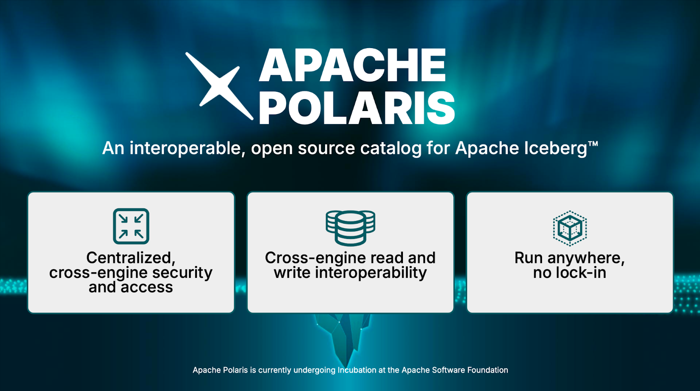

A significant component of Apache Polaris is its commitment to open accessibility and regulatory compliance. By supporting major data protection and privacy frameworks like GDPR, CCPA, and HIPAA, Apache Polaris helps organizations meet critical regulatory standards. This focus on compliance and secure data governance reduces risk while fostering greater confidence in how data is stored, accessed, and analyzed.

### **Key Features & Benefits**

Apache Polaris offers several key features and benefits that users should know. Diving a bit deeper, based on the image above, here are some noteworthy benefits:

#### Cross-Engine Read and Write

Apache Polaris leverages Apache Iceberg's open-source REST protocol, enabling multiple engines to read and write data seamlessly. This interoperability extends to popular engines like PuppyGraph, [Apache Flink](https://flink.apache.org/), [Apache Spark](https://spark.apache.org/), [Trino](https://trino.io/), and many others, ensuring flexibility and choice for users. 

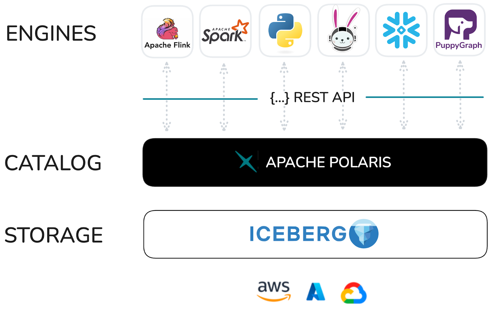

#### Centralized Security and Access

With Apache Polaris, you can define principals/users and roles, and manage RBAC (Role-Based Access Controls) on Iceberg tables for these users or roles. This centralized security management approach streamlines access control and simplifies data governance.  

#### Run Anywhere, No Lock-In

Apache Polaris offers deployment flexibility, allowing you to run it in your own infrastructure within a container (e.g., Docker, Kubernetes) or as a managed service on Snowflake. This adaptability ensures you can retain RBAC, namespaces, and table definitions even if you switch infrastructure, providing long-term flexibility and cost optimization.

The Apache Polaris offers various ways to query, analyze, and integrate data, one of the most flexible and scalable options for organizations to store and govern data effectively.

## Why Add Graph Capabilities to Apache Polaris?

While SQL querying is a mainstay for most developers dealing with data and traditional SQL queries are highly effective for many data operations, they can fall short when working with highly interconnected data. Specific use cases lend themselves to graph querying, such as:

* **Social Network Analysis:** Understanding relationships between people, groups, and organizations.  
* **Fraud Detection:** Identifying patterns and anomalies in financial transactions or online activities.  
* **Knowledge Graphs:** Representing and querying complex networks of interconnected concepts and entities.  
* **Recommendation Engines:** Suggesting products, services, or content based on user preferences and relationships.  
* **Network and IT Infrastructure Analysis:** Modeling and analyzing network topologies, dependencies, and performance. 

Enhancing Apache Polaris with a graph query engine introduces advanced graph analytics, making it easier and more intuitive to handle complex, relationship-based queries like the ones mentioned above. Here's why integrating graph capabilities benefits querying in Apache Polaris:

* **Enhanced Data Relationships**: Graph queries are designed to uncover complex patterns within data, making them particularly useful for exploring multi-level relationships or hierarchies that can be cumbersome to analyze with SQL.  
* **Performance**: When traversing extensive relationships, graph queries are often faster than SQL, especially for deep link analysis, as graph databases are optimized for this type of network traversal.  
* **Flexibility**: Graph databases allow for a more intuitive approach to modeling interconnected data, avoiding the need for complex `JOIN` operations common in SQL queries. Nodes and edges in graph models naturally represent connections, simplifying queries for relationship-based data.  
* **Advanced Analytics**: Graph platforms support advanced analytics, such as community detection, shortest path calculations, and centrality measures. Many of these algorithms are built into graph platforms, making them more accessible and efficient than implementing such analytics manually in SQL.

Users gain deeper insights, faster query performance, and simpler ways to handle complex data structures by adding the capability to perform graph-based querying and analytics within Apache Polaris. When adding these capabilities, PuppyGraph’s zero-ETL graph query engine integrates seamlessly with Apache Polaris, making it easy and fast to unlock these advantages. Let’s look at how seamlessly the two platforms fit together architecturally.

## Apache Polaris \+ PuppyGraph Architecture

Traditionally, enabling graph querying and analytics on organizational data required replicating data into a separate graph database before running queries. This complex process involved multiple technologies, teams, and a significant timeline. Generally, the most cumbersome part of the equation was the struggling of ETL to get the data transformed into a graph-compatible format and actually loaded into the database. Because of this, implementing graph analytics on data stored in SQL-based systems has historically been challenging, so graph analysis was often viewed as a niche technology—valuable but costly to implement.

PuppyGraph overcomes these limitations by offering a novel approach: adding graph capabilities without needing a dedicated graph database. Removing the graph database from the equation shortens the implementation timeline, reducing both time-to-market and overall costs. With PuppyGraph’s Zero-ETL graph query engine, users can connect directly to the data source, enabling graph queries directly on an Apache Polaris instance while maintaining fine-grained governance and lineage.

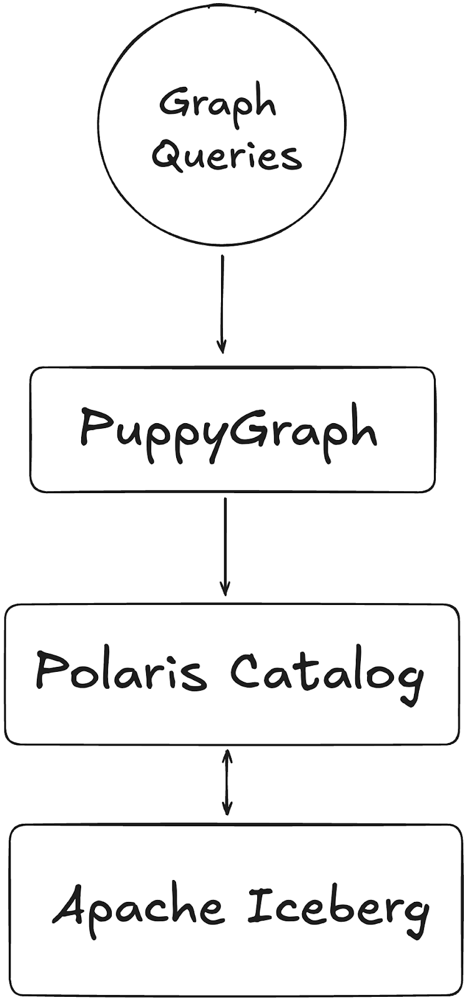

This approach allows for performant graph querying, such as supporting 10-hop neighbor queries across half a billion edges in 2.26 seconds through scalable and performant zero-ETL. PuppyGraph achieves this by leveraging the column-based data file format coupled with massively parallel processing and vectorized evaluation technology built into the PuppyGraph engine. This distributed compute engine design ensures fast query execution even without efficient indexing and caching, delivering a performant and efficient graph querying and analytics experience without the hassles of the traditional graph infrastructure.

To prove just how easy it is, let's look at how you can connect PuppyGraph to the data you have stored in Apache Polaris.

## Connecting PuppyGraph to Apache Polaris 

Enabling graph capabilities on your underlying data is extremely simple with PuppyGraph. We like to summarize it into three steps: deploy, connect, and query. Many users can be up and running in a matter of minutes. We’ll walk through the steps below to show how easy it is.

### Deploy Apache Polaris

Check out the code from the Apache Polaris repository.  
```shell
git clone https://github.com/apache/polaris.git
```

JDK 21 is required to build and run Apache Polaris. Polaris dev mode listens on localhost by default. Allow connections from the PuppyGraph Docker container when starting the server:
```shell   
cd polaris  
QUARKUS_HTTP_HOST=0.0.0.0 ./gradlew run
```

Use this setup only in an isolated development environment. Polaris listens on all network interfaces and uses the default `root:s3cr3t` credentials; restrict access to port `8181` to the local host and the PuppyGraph container.

Then use the provided spark shell to create a data catalog and prepare data. Start a different shell and run the following command in the polaris directory: 
```shell 
./regtests/run_spark_sql.sh
```

The command will download Spark and start a Spark SQL shell. Run the following command to generate a new database and several tables in this newly created catalog. 
```sql 
CREATE DATABASE IF NOT EXISTS modern;

CREATE TABLE modern.person (id string, name string, age int) USING iceberg;
INSERT INTO modern.person VALUES
                              ('v1', 'marko', 29),
                              ('v2', 'vadas', 27),
                              ('v4', 'josh', 32),
                              ('v6', 'peter', 35);

CREATE TABLE modern.software (id string, name string, lang string) USING iceberg;
INSERT INTO modern.software VALUES
                                ('v3', 'lop', 'java'),
                                ('v5', 'ripple', 'java');

CREATE TABLE modern.created (id string, from_id string, to_id string, weight double) USING iceberg;
INSERT INTO modern.created VALUES
                               ('e9', 'v1', 'v3', 0.4),
                               ('e10', 'v4', 'v5', 1.0),
                               ('e11', 'v4', 'v3', 0.4),
                               ('e12', 'v6', 'v3', 0.2);

CREATE TABLE modern.knows (id string, from_id string, to_id string, weight double) USING iceberg;
INSERT INTO modern.knows VALUES
                             ('e7', 'v1', 'v2', 0.5),
                             ('e8', 'v1', 'v4', 1.0);
```
### Deploy PuppyGraph

Then you’ll need to deploy PuppyGraph. Luckily, this is easy and can currently be done through Docker (see [Docs](https://docs.puppygraph.com/getting-started)) or an [AWS AMI](https://aws.amazon.com/marketplace/pp/prodview-dgmn5jnwnfacu) through AWS Marketplace. The AMI approach requires a few clicks and will deploy your instance on the infrastructure of your choice. Below, we will focus on what it takes to launch a PuppyGraph instance on Docker.

With Docker installed, you can run the following command in your terminal:
```shell
docker run -p 8081:8081 -p 8183:8182 -p 7687:7687 -v /tmp/polaris:/tmp/polaris --name puppy --rm -itd puppygraph/puppygraph:latest
```

The commands and JSON below target PuppyGraph 1.x. The walkthrough and screenshots were tested with PuppyGraph 1.17.0. See the [migration guide](https://docs.puppygraph.com/modeling/migrating-from-v0/) for existing 0.x schemas.

This will spin up a PuppyGraph instance on your local machine (or on a cloud or bare metal server if that's where you want to deploy it). Next, you can go to **localhost:8081** or the URL on which you launched the instance. This will show you the PuppyGraph login screen:

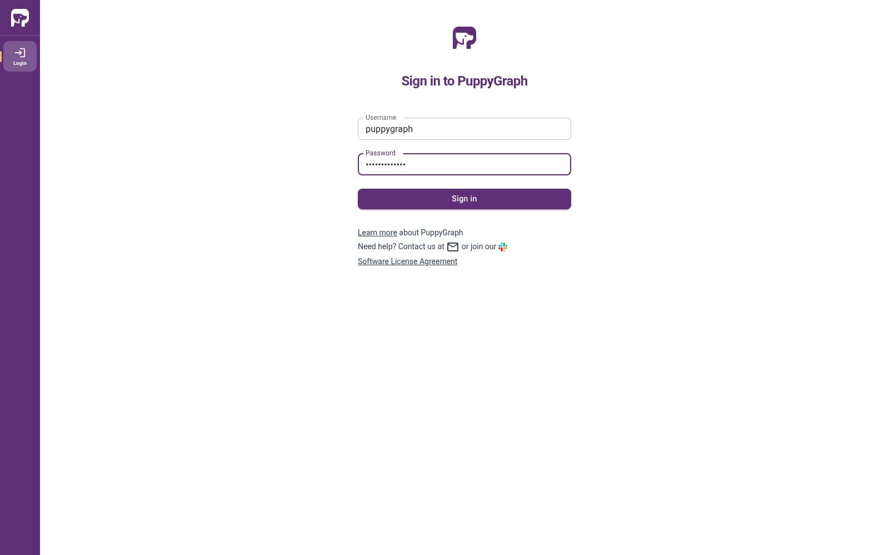

After logging in with the default credentials (username: “`puppygraph”` and default password: “`puppygraph123`”) you’ll enter the application itself. At this point, our instance is ready to go and we can proceed with connecting to the underlying data stored in Apache Polaris.

### Connect to Your Data Source and Define Your Schema

Next, we must connect to our data source to run graph queries against it. Users have a choice of how they would like to go about this. Firstly, you could use a JSON schema document to define your connectivity parameters and data mapping. The example below uses the PuppyGraph 1.x schema format. Replace the connection settings with those for your deployment. The `172.17.0.1` address is for the Linux Docker setup shown here; on Docker Desktop, use `http://host.docker.internal:8181/api/catalog` as the metastore URI:
```json
{
  "catalog": [
    {
      "name": "test",
      "type": "iceberg",
      "metastore": {
        "type": "rest",
        "uri": "http://172.17.0.1:8181/api/catalog",
        "warehouse": "manual_spark",
        "security": "oauth2",
        "credential": "root:s3cr3t",
        "scope": "PRINCIPAL_ROLE:ALL"
      }
    }
  ],
  "node": [
    {
      "label": "person",
      "dataSourceGroup": {
        "externalDataSource": {
          "enabled": true,
          "catalog": "test",
          "schema": "modern",
          "table": "person",
          "mappedField": [
            {
              "sourceFieldName": "id",
              "targetFieldName": "id"
            },
            {
              "sourceFieldName": "name",
              "targetFieldName": "name"
            },
            {
              "sourceFieldName": "age",
              "targetFieldName": "age"
            }
          ]
        }
      },
      "id": [
        {
          "name": "id",
          "type": "String"
        }
      ],
      "attribute": [
        {
          "name": "name",
          "type": "String"
        },
        {
          "name": "age",
          "type": "Int"
        }
      ]
    },
    {
      "label": "software",
      "dataSourceGroup": {
        "externalDataSource": {
          "enabled": true,
          "catalog": "test",
          "schema": "modern",
          "table": "software",
          "mappedField": [
            {
              "sourceFieldName": "id",
              "targetFieldName": "id"
            },
            {
              "sourceFieldName": "name",
              "targetFieldName": "name"
            },
            {
              "sourceFieldName": "lang",
              "targetFieldName": "lang"
            }
          ]
        }
      },
      "id": [
        {
          "name": "id",
          "type": "String"
        }
      ],
      "attribute": [
        {
          "name": "name",
          "type": "String"
        },
        {
          "name": "lang",
          "type": "String"
        }
      ]
    }
  ],
  "edge": [
    {
      "label": "created",
      "fromNodeLabel": "person",
      "toNodeLabel": "software",
      "dataSourceGroup": {
        "externalDataSource": {
          "enabled": true,
          "catalog": "test",
          "schema": "modern",
          "table": "created",
          "mappedField": [
            {
              "sourceFieldName": "id",
              "targetFieldName": "id"
            },
            {
              "sourceFieldName": "from_id",
              "targetFieldName": "from_id"
            },
            {
              "sourceFieldName": "to_id",
              "targetFieldName": "to_id"
            },
            {
              "sourceFieldName": "weight",
              "targetFieldName": "weight"
            }
          ]
        }
      },
      "id": [
        {
          "name": "id",
          "type": "String"
        }
      ],
      "fromKey": [
        {
          "name": "from_id",
          "type": "String"
        }
      ],
      "toKey": [
        {
          "name": "to_id",
          "type": "String"
        }
      ],
      "attribute": [
        {
          "name": "weight",
          "type": "Double"
        }
      ]
    },
    {
      "label": "knows",
      "fromNodeLabel": "person",
      "toNodeLabel": "person",
      "dataSourceGroup": {
        "externalDataSource": {
          "enabled": true,
          "catalog": "test",
          "schema": "modern",
          "table": "knows",
          "mappedField": [
            {
              "sourceFieldName": "id",
              "targetFieldName": "id"
            },
            {
              "sourceFieldName": "from_id",
              "targetFieldName": "from_id"
            },
            {
              "sourceFieldName": "to_id",
              "targetFieldName": "to_id"
            },
            {
              "sourceFieldName": "weight",
              "targetFieldName": "weight"
            }
          ]
        }
      },
      "id": [
        {
          "name": "id",
          "type": "String"
        }
      ],
      "fromKey": [
        {
          "name": "from_id",
          "type": "String"
        }
      ],
      "toKey": [
        {
          "name": "to_id",
          "type": "String"
        }
      ],
      "attribute": [
        {
          "name": "weight",
          "type": "Double"
        }
      ]
    }
  ]
}
```

In the example, you can see the data store details under the **catalog** section. This is all that is needed to connect to the Apache Polaris instance. Underneath the **catalog** section, you’ll notice that we have defined the nodes and edges and where the data comes from. This tells PuppyGraph how to map the SQL data into the graph hosted within PuppyGraph. This can then be uploaded to PuppyGraph, and you’ll be ready to query\!

Save the schema to a JSON file and adjust the connection settings for your Polaris deployment. On the **Graph** page, choose **Upload JSON**, then **Select Schema File**. Review the preview and click **Upload**. When the upload succeeds, click **Close**.

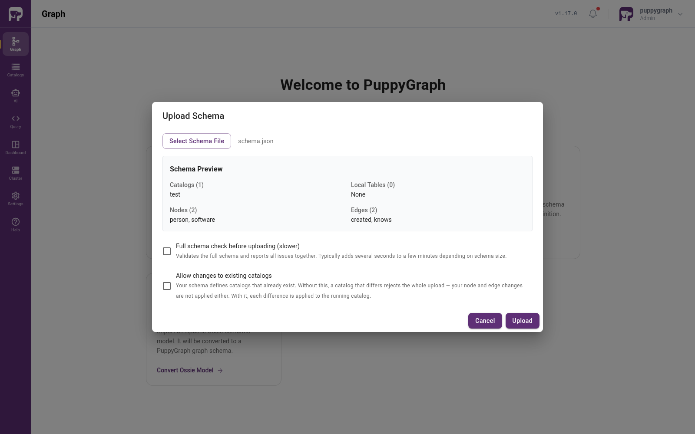

Alternatively, you can build the same graph through the UI. From the **Graph** welcome page, choose **Create Catalog**, select **Apache Iceberg**, and configure the Polaris connection:

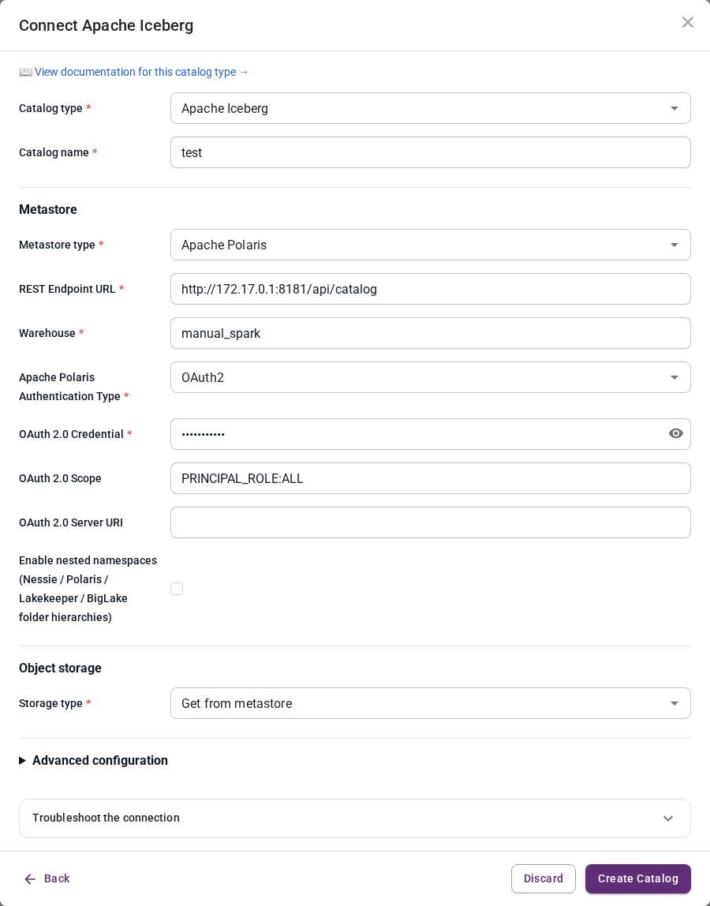

* Catalog name: `test`.
* Metastore type: `Apache Polaris`.
* REST Endpoint URL: `http://172.17.0.1:8181/api/catalog` for the Linux Docker setup shown here. Use the host address reachable from your PuppyGraph container; on Docker Desktop, this is typically `http://host.docker.internal:8181/api/catalog`.
* Warehouse: `manual_spark`, created by `run_spark_sql.sh`.
* Apache Polaris Authentication Type: `OAuth2`.
* OAuth 2.0 Credential: `root:s3cr3t` for this local Polaris dev server. Use your own principal credentials for another deployment.
* OAuth 2.0 Scope: `PRINCIPAL_ROLE:ALL`.
* Storage type: `Get from metastore`.

Click **Create Catalog**. Then choose **Add Node**, expand `test` → `modern`, select a table, and click **Next**. Use **Add to ID** to move `id` into **ID Columns** and keep the other columns as attributes:

| Table | Node label | ID column | Attribute columns |
|---|---|---|---|
| `person` | `person` | `id` | `name`, `age` |
| `software` | `software` | `id` | `name`, `lang` |

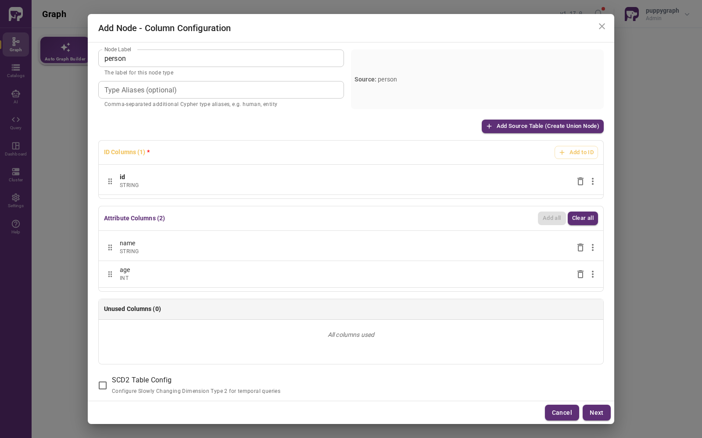

For each node, click **Next**, leave **Enable Local Replication** disabled, and click **Add Node**.

Next, choose **Add Edge**, select the corresponding table under `test` → `modern`, click **Next**, and configure the endpoints:

| Table / edge label | From node | From column → node ID | To node | To column → node ID |
|---|---|---|---|---|
| `created` | `person` | `from_id` → `id` | `software` | `to_id` → `id` |
| `knows` | `person` | `from_id` → `id` | `person` | `to_id` → `id` |

For both edges, use **Add to ID** to select `id`. Keep only `weight` under **Attribute Columns**: remove `from_id` and `to_id` from the attribute list after selecting them as endpoint columns.

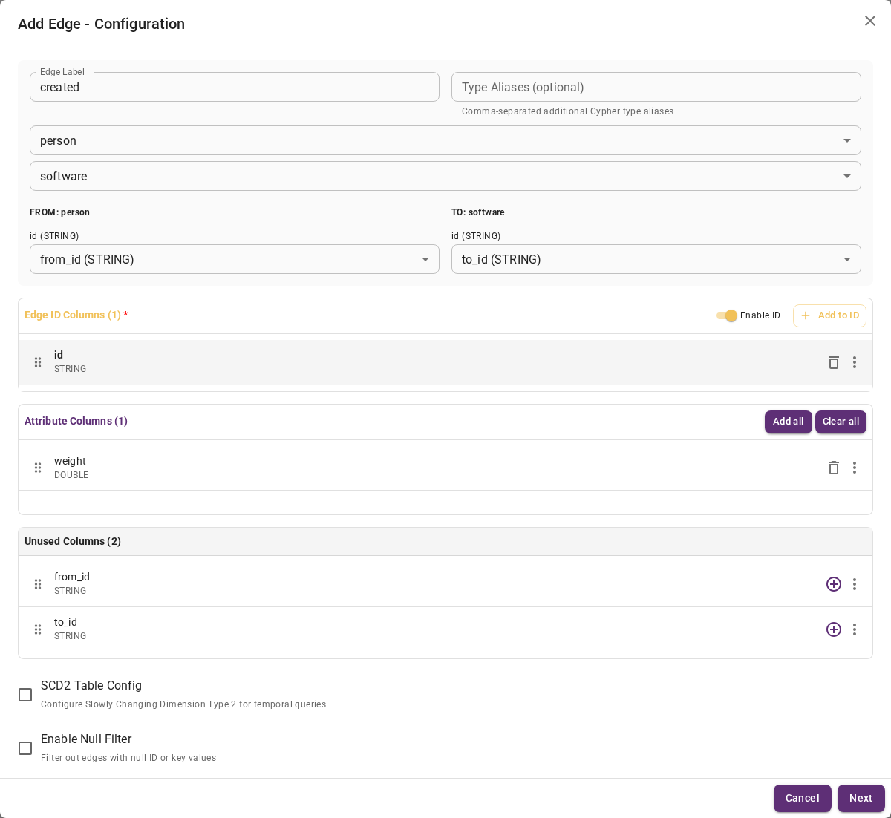

Click **Next**, leave **Enable Local Replication** disabled, and click **Add Edge**. Each node and edge is applied when added. The completed **Graph** page shows the two node types and their relationships:

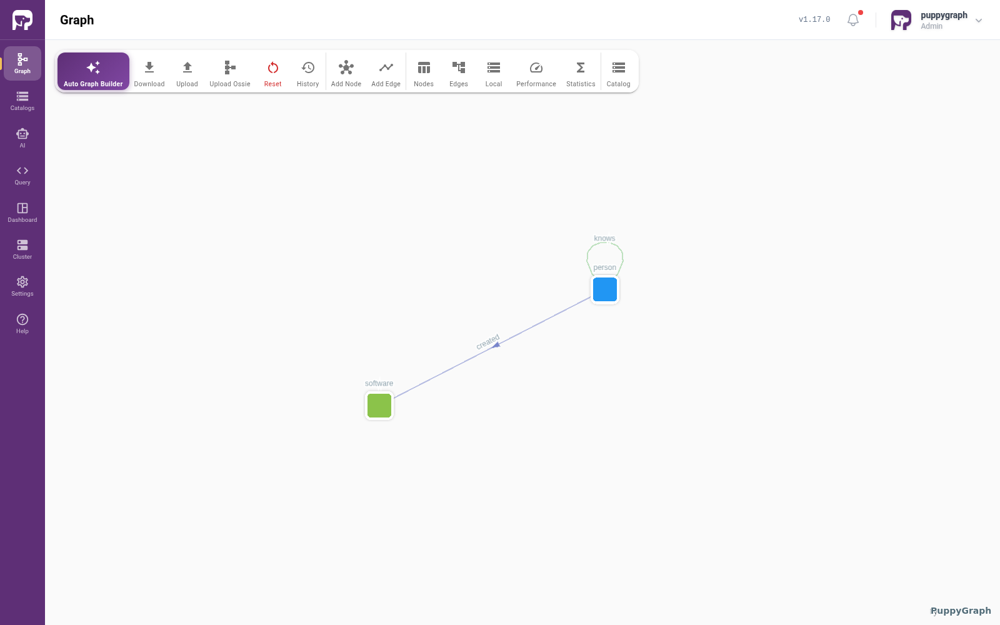

### Query your Data as a Graph

Choose **Query** in the sidebar. If the language button shows **Cypher**, click it to switch to **Gremlin**. Enter the following query and click **Execute**:

```groovy
g.V().outE().inV().path()
```

The **Graph** tab visualizes the sample data: six vertices and six edges.

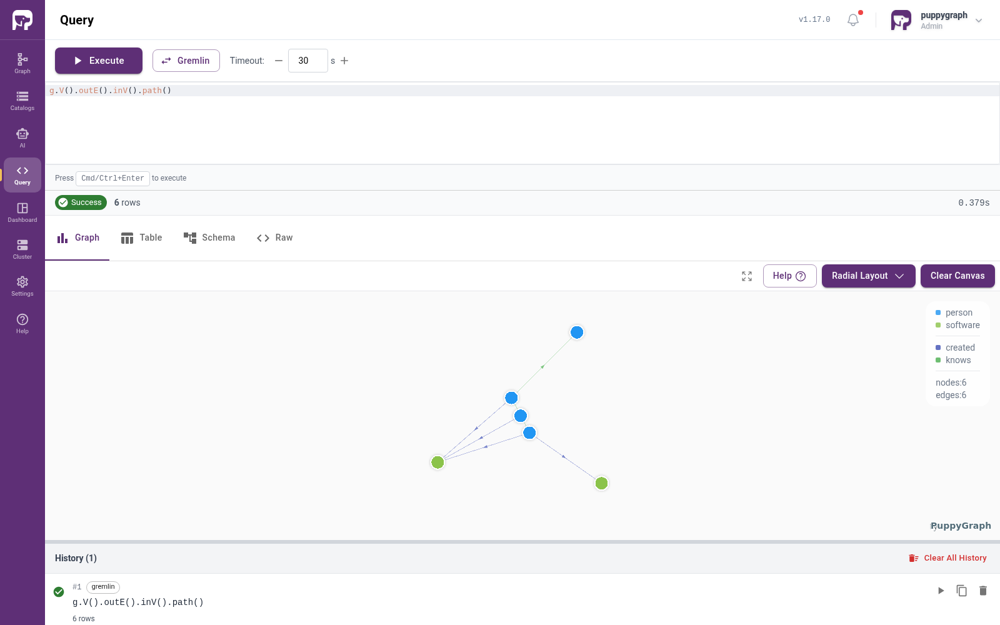

To find the software created by people Marko knows, run:

```groovy
g.V().has("name", "marko").out("knows").out("created").valueMap()
```

Select the **Table** tab to inspect the results. The query returns `lop` and `ripple`, both with `lang` set to `java`.

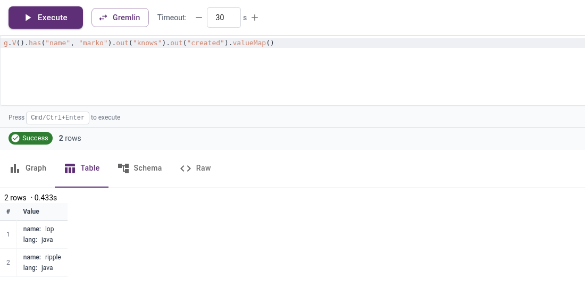

As you can see, graph capabilities can be achieved with PuppyGraph in minutes without the heavy lift usually associated with graph databases. Whether you’re a seasoned graph professional looking to expand the data you have to query as a graph or a budding graph enthusiast testing out a use case, PuppyGraph offers a performant and straightforward way to add graph querying and analytics to the data you have sitting within Apache Polaris.

## Summary

In this blog, we looked at how to enable real-time graph querying with PuppyGraph’s zero-ETL graph query engine and how to pair it with Apache Polaris. In a matter of minutes, we explored how PuppyGraph can be deployed and connected to your Apache Polaris instance, enabling graph queries without the overhead of traditional graph technologies.

Everything in this guide is free to try. You can download PuppyGraph's [forever-free Developer Edition](https://www.puppygraph.com/dev-download) and start running graph queries on your Apache Polaris instance with fine-grained governance & lineage in 10 minutes. You can also check the [instructions for connecting to an Apache Polaris Catalog](https://docs.puppygraph.com/getting-started/querying-polaris-catalog-data-as-a-graph/) in PuppyGraph Documentation.